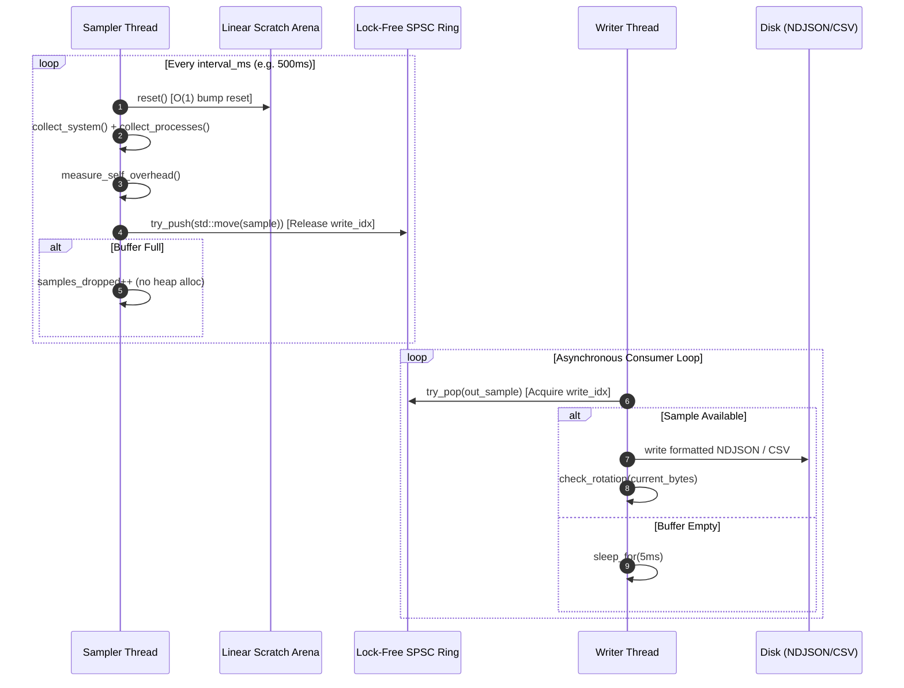

# SysPulse Architecture & Design Specification

SysPulse is a cross-platform (Linux + Windows) systems telemetry daemon engineered in modern C++17. It decouples high-frequency OS performance sampling from I/O serialization using lock-free data structures and custom bump allocators.

---

## 1. System Architecture Diagram

```mermaid
flowchart TD
    subgraph OS_Kernel_Subsystems ["OS Kernel Subsystems"]
        LinuxProc["Linux Kernel\n/proc/stat, /proc/meminfo,\n/proc/[pid]/*"]
        WinKernel["Windows NT Kernel\nPDH, Toolhelp32, PSAPI,\nKernel ETW Session"]
    end

    subgraph Collection_Tier ["SysPulse Telemetry Agent"]
        direction TB
        Collector["ICollector\n(ProcCollector / WinProcessCollector)"]
        Arena["ArenaAllocator\n(Per-Cycle Linear Bump Allocator)"]
        Sampler["Sampler Thread\n(sleep_until, Top-N Sort, Filter)"]
        Ring["SpscRingBuffer<Sample>\n(Lock-Free, Cache-Line Padded, Acquire/Release)"]
        Writer["Writer Thread\n(NDJSON / CSV Serializer)"]
        SelfMon["Self Diagnostics\n(Agent CPU% & RSS Tracking)"]
    end

    subgraph Storage_And_Export ["Data Pipeline & Analytics"]
        DiskLogs["Rotated Log Files\n(samples.ndjson / samples.csv)"]
        PythonAnalysis["Python Analysis Engine\n(Robust z-score, EWMA, OLS Leaks)"]
        KQL["Azure Data Explorer (KQL)\n(Time Series Decomposition & Ingestion)"]
        Report["Diagnostics Report & Charts\n(DIAGNOSTIC_REPORT.md, Figures)"]
    end

    LinuxProc -.->|procfs| Collector
    WinKernel -.->|Win32 / ETW| Collector
    Arena -->|Scratch Memory| Collector
    Collector --> Sampler
    SelfMon --> Sampler
    Sampler -->|try_push (move)| Ring
    Ring -->|try_pop| Writer
    Writer -->|Batched Flush / Rotate| DiskLogs
    DiskLogs --> PythonAnalysis
    DiskLogs -.-> KQL
    PythonAnalysis --> Report
```

---

## 2. Core Components & Threading Model

SysPulse employs a strict Single-Producer Single-Consumer (SPSC) concurrency model:



### The Sampler Thread
* **Responsibility**: Queries system counters, processes, and agent self-statistics at strict, drift-free intervals using `std::this_thread::sleep_until()`.
* **Zero Allocation Hot Path**: Scratch operations utilize a 1 MB preallocated `ArenaAllocator`. At the start of each sampling cycle, `scratch_arena_.reset()` executes in $O(1)$ time by rewinding the bump offset without making system calls (`malloc`/`free`).
* **Non-Blocking Publishing**: Pushes assembled `Sample` structs to the ring buffer via `ring_buffer_->try_push(std::move(sample))`. If the consumer falls behind and the buffer is saturated, the sample is dropped and recorded in `self_stats.ring_buffer_dropped_samples` rather than blocking the sampler.

### The Writer Thread
* **Responsibility**: Drains the ring buffer and serializes records to disk.
* **Rotation**: Evaluates file size against `max_file_size_bytes` (default 50 MB) and rotates files (`samples.ndjson.1`, etc.).
* **Full Flush Shutdown**: Upon receiving a termination signal (`SIGINT`, `SIGTERM`, console control event), the writer enters a drain loop to write all buffered records to disk before closing file handles.

---

## 3. Data Structures & Concurrency Guarantees

### SPSC Ring Buffer (`spsc_ring_buffer.hpp`)
* **Power-of-Two Capacity**: Enables bitwise masking (`idx & (capacity - 1)`) instead of expensive integer division.
* **Cache-Line Alignment**: `write_idx_` and `read_idx_` are decorated with `alignas(64)`. This guarantees they reside on distinct L1 cache lines, preventing cache ping-ponging (false sharing) between CPU cores.
* **Explicit Memory Ordering**:
  * Producer writes slot data, then executes `write_idx_.store(curr + 1, std::memory_order_release)`.
  * Consumer executes `write_idx_.load(std::memory_order_acquire)`, reads slot data, then executes `read_idx_.store(curr + 1, std::memory_order_release)`.
  * Producer executes `read_idx_.load(std::memory_order_acquire)` to confirm available slots.

---

## 4. Design Trade-Offs

| Decision | Chosen Solution | Alternative Considered | Justification |
|---|---|---|---|
| Inter-thread Queue | Lock-Free SPSC Ring Buffer | Mutex-guarded `std::queue` | Eliminates lock contention, priority inversion, and syscall overhead on the sampling hot path. |
| Memory Management | Linear Bump Arena | Standard Heap (`malloc` / `new`) | Prevents heap fragmentation and unpredictable latency spikes during multi-process collection. |
| Error Handling | Value-semantic `Result<T, E>` | C++ Exceptions | Telemetry frequently encounters transient errors (process vanished, permission denied); exceptions incur heavy stack-unwinding overhead. |
| Serialization Format | Newline-Delimited JSON (NDJSON) | Binary Protobuf / FlatBuffers | Human-readable, stream-appendable, and directly ingestible into Azure Data Explorer (ADX) and Pandas without schema compilation. |
