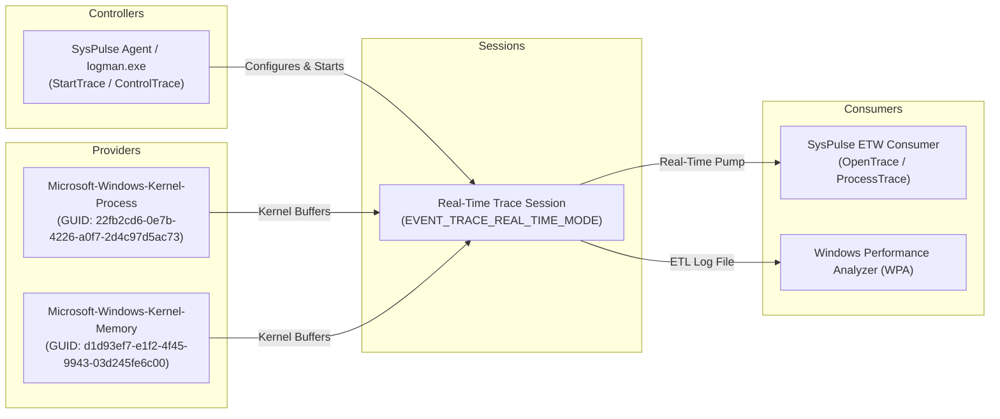

# Event Tracing for Windows (ETW) Integration Guide

This document describes how SysPulse leverages Event Tracing for Windows (ETW) for kernel-level diagnostics, how to analyze the captured telemetry, and how to verify the events using standard Windows diagnostic tools (`logman`, `tracerpt`, `wpa`, `perfview`).

---

## 1. ETW Architecture Overview

Event Tracing for Windows is a high-speed, kernel-level tracing facility built into the Windows NT kernel. It comprises four primary components:



1. **Controllers**: Start and stop trace sessions, enable/disable providers, and manage buffer configurations (e.g., `StartTraceW`, `EnableTraceEx2`, `ControlTraceW`).
2. **Providers**: Software components (kernel drivers or user-mode DLLs) that publish events to trace sessions when instrumented code paths execute.
3. **Sessions**: Kernel-managed memory pools that buffer events between providers and consumers. SysPulse uses `EVENT_TRACE_REAL_TIME_MODE` for instantaneous stream consumption without writing intermediate `.etl` files to disk.
4. **Consumers**: Applications that subscribe to a session and process event streams via `OpenTraceW` and `ProcessTrace`.

---

## 2. Providers Used by SysPulse

### `Microsoft-Windows-Kernel-Process`
* **GUID**: `{22fb2cd6-0e7b-4226-a0f7-2d4c97d5ac73}`
* **Events Captured**:
  * **Opcode 1 (ProcessStart)**: Emitted whenever `NtCreateUserProcess` completes. Captures parent PID, child PID, command line, image filename, and creation time.
  * **Opcode 2 (ProcessStop)**: Emitted upon process termination (`NtTerminateProcess`). Captures exit status, CPU user/kernel execution totals, and peak working set.
* **Why Chosen**: Allows SysPulse to detect ephemeral processes (churn) that start and terminate in under 500ms, which polling-based snapshotters (`Toolhelp32`) inevitably miss.

### `Microsoft-Windows-Kernel-Memory`
* **GUID**: `{d1d93ef7-e1f2-4f45-9943-03d245fe6c00}`
* **Events Captured**:
  * Hard and soft page faults, memory commit/decommit, and working set trimming.
* **Why Chosen**: Correlates process working-set spikes directly with system-wide page fault storms.

---

## 3. Real-Time Processing via TDH (Trace Data Helper)

SysPulse decodes event structures dynamically using the Windows Trace Data Helper (TDH) API:
1. `EventRecordCallback`: Receives raw `PEVENT_RECORD`.
2. `TdhGetEventInformation`: Queries the event schema to extract property names, types, and values dynamically, eliminating fragile static offsets across Windows kernel versions.

---

## 4. Reproducing and Verifying with Windows Built-In Tools

You can verify the same event stream using native Windows CLI diagnostics without running SysPulse:

### A. Capturing Kernel Process Events via `logman`
Run from an elevated PowerShell / CMD prompt:

```cmd
:: 1. Create and start a kernel trace session targeting process events
logman create trace SysPulseValidation -p "{22fb2cd6-0e7b-4226-a0f7-2d4c97d5ac73}" 0x10 4 -ets

:: 2. Launch any workload to generate events (e.g. notepad.exe)
start notepad.exe
timeout /t 2
taskkill /f /im notepad.exe

:: 3. Stop the session
logman stop SysPulseValidation -ets
```

### B. Dumping Events to XML / Text via `tracerpt`
Convert the resulting trace buffer to human-readable XML or CSV:

```cmd
tracerpt SysPulseValidation.etl -o process_events.xml -of XML
```

Inspect `process_events.xml` to observe the identical `ProcessStart` and `ProcessStop` records that SysPulse processes in real-time.

### C. Analyzing Traces in Windows Performance Analyzer (WPA)
1. Open the `.etl` trace in Windows Performance Analyzer (`wpa.exe`).
2. Navigate to **System Activity** -> **Processes** -> **Lifetime**.
3. Drag the graph into the analysis canvas to view exact process start times, exit codes, and lifetimes.
